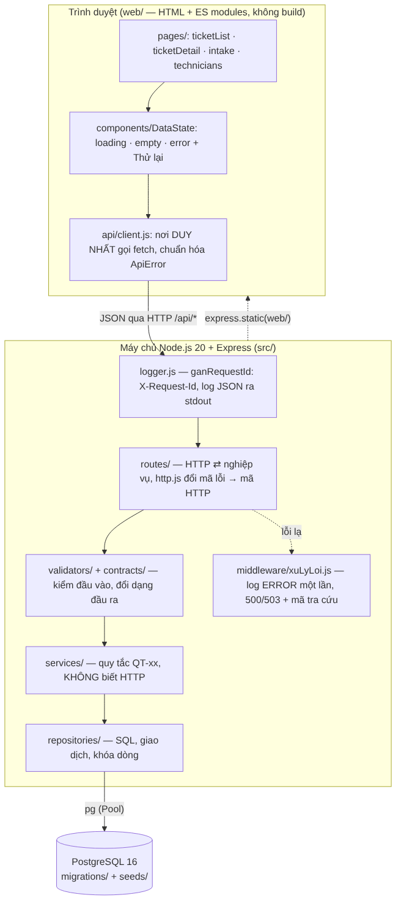

# Kiến trúc thực tế đã hiện thực (BT2, tag v0.2)

Tài liệu này mô tả hệ thống **như đang chạy**, khác với `docs/architecture.drawio` (kiến trúc thiết kế ở BT1). Các điểm khác thiết kế được ghi ở `docs/thay-doi-thiet-ke.md` (TD-xx).

Mã nguồn của hình: `docs/architecture-thuc-te.mmd` (Mermaid).

## 1. Kiểu kiến trúc

Modular monolith nhiều lớp: **một** tiến trình Node.js 20 + Express phục vụ cả API (`/api/*`) lẫn giao diện tĩnh (`web/`), nói chuyện với **một** CSDL PostgreSQL 16. Không có hàng đợi, bộ nhớ đệm hay dịch vụ ngoài. Đây đúng là phương án đã chọn ở BT1 (một nhóm, quy mô nhỏ), nên thay đổi so với thiết kế chỉ là chi tiết (mục 4).

## 2. Các lớp và trách nhiệm

| Lớp | Thư mục | Trách nhiệm | Không được làm |
|---|---|---|---|
| Giao diện | `web/src/pages/`, `components/`, `lib/` | Vẽ màn hình; ba trạng thái đang tải / rỗng / lỗi (có nút Thử lại) qua `DataState` | Gọi `fetch` trực tiếp |
| Client API | `web/src/api/client.js`, `tickets.api.js`, `technicians.api.js` | Nơi DUY NHẤT gọi `fetch`; đổi mọi lỗi thành `ApiError` | Chứa quy tắc nghiệp vụ |
| Routes | `src/routes/` | Đổi HTTP thành lời gọi nghiệp vụ và ngược lại; `http.js` là chỗ duy nhất đổi mã lỗi nghiệp vụ sang mã HTTP | Chứa quy tắc nghiệp vụ hay SQL |
| Validators / Contracts | `src/validators/`, `src/contracts/` | Kiểm định dạng đầu vào (tầng 1); đổi đối tượng nghiệp vụ (camelCase) sang JSON API (snake_case) | Truy cập CSDL |
| Services | `src/services/` | Quy tắc nghiệp vụ QT-02, QT-04, QT-06, QT-07, QT-08, QT-13; điều phối giao dịch | Dùng `req`, `res` hay mã HTTP |
| Repositories | `src/repositories/` | Toàn bộ SQL, giao dịch (`runInTransaction`), khóa dòng `FOR UPDATE` | Chứa quy tắc nghiệp vụ |
| Middleware | `src/logger.js`, `src/middleware/xuLyLoi.js` | `requestId`, log JSON ra stdout, xử lý lỗi hệ thống một lần | Ghi số điện thoại, bí mật vào log |
| Dữ liệu | `migrations/`, `seeds/`, `src/db/runner.js` | Dựng bảng và nạp dữ liệu mẫu, chạy lại được không nhân đôi | |

Thứ tự đăng ký trong `src/app.js`: `ganRequestId` → `express.json` → `/health` → `/api/technicians` → `/api/tickets` → `express.static(web)` → 404 → bộ xử lý lỗi cuối.

## 3. Luồng chạy chính: phân công kỹ thuật viên (UC3)

1. Trang chi tiết phiếu gọi `GET /api/tickets/{id}/eligible-technicians` qua `client.js`; service lọc kỹ thuật viên đủ điều kiện QT-08 (cùng trung tâm, đang hoạt động, thành thạo ≥ 3) và sắp theo số phiếu đang giữ.
2. Quản lý chọn một kỹ thuật viên, bấm "Xác nhận phân công": `POST /api/tickets/{id}/assignment`.
3. Routes kiểm đầu vào (`validateAssignment`), gọi `service.assign`.
4. Service mở **một giao dịch**: khóa dòng phiếu (`FOR UPDATE`), kiểm phiếu còn `MOI` (QT-07), kiểm lại QT-08, cập nhật phiếu sang `DA_PHAN_CONG`, ghi `ticket_status_log` (QT-06), rồi COMMIT. Lỗi ở bước nào thì ROLLBACK, phiếu giữ nguyên `MOI`.
5. Phản hồi 201; giao diện hiện thông báo phân công thành công.

Đường lỗi: lỗi người dùng (400, 404, 409) được `routes/http.js` đổi thành khung lỗi chung `{ error: { code, message, field?, fields? } }` và ghi INFO; lỗi hệ thống (500) và mất kết nối CSDL (503) rơi xuống `middleware/xuLyLoi.js`, ghi ERROR đúng một lần và trả kèm mã tra cứu (`requestId`).

## 4. Khác biệt so với kiến trúc BT1

| Nội dung | BT1 (thiết kế) | Thực tế | Chi tiết |
|---|---|---|---|
| Giao diện | Ứng dụng web riêng | HTML + ES modules thuần do chính Express phục vụ, không có bước build | TD-20, TD-24 |
| Đăng nhập, phân quyền JWT | Có | Chưa làm; `assigned_by = 0` khi chưa có người dùng | TD-18, TD-23 |
| Đổi kỹ thuật viên, lịch hẹn (UC6, UC7) | Có | Chưa hiện thực | `docs/thay-doi-thiet-ke.md` mục 8 |
| Logging và lỗi | Chưa nêu | Log JSON ra stdout có `requestId`; bộ xử lý lỗi duy nhất | TD-25 |
| Sửa và hủy phiếu | Chưa nêu | `PATCH` và `DELETE` mềm cho phiếu | TD-26 |
| Container | Docker Compose | Đang bổ sung ở buổi 11–12 (xem README mục 6) | |

## 5. Dữ liệu và triển khai

- **CSDL:** 6 bảng theo ERD BT1 (`customer`, `technician`, `technician_skill`, `ticket`, `appointment`, `ticket_status_log`); `migrations/001_init.sql` dựng bảng, `seeds/001–004` nạp 38 kỹ thuật viên, 159 kỹ năng, 1.063 khách và 1.098 phiếu (12 phiếu `MOI` cho luồng phân công).
- **Cấu hình:** hoàn toàn qua biến môi trường (`.env.example`): `PORT`, `DATABASE_URL`, `DB_POOL_MAX`, `LOG_LEVEL`, ...
- **Chạy:** các bước ở README mục 3 (`npm ci`, `npm run migrate`, `npm run seed`, `npm start`); kiểm thử bằng `npm test` (không cần CSDL).
