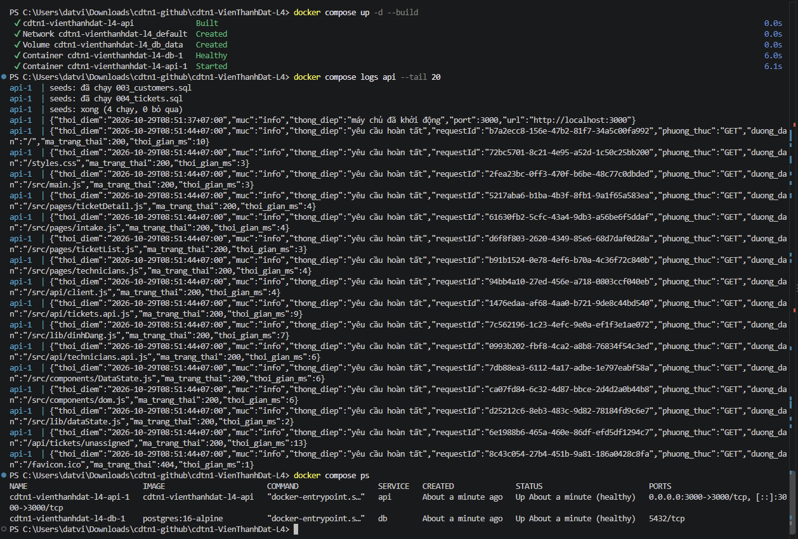
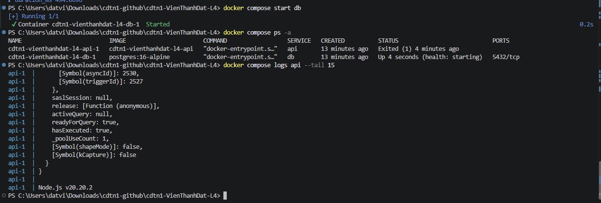
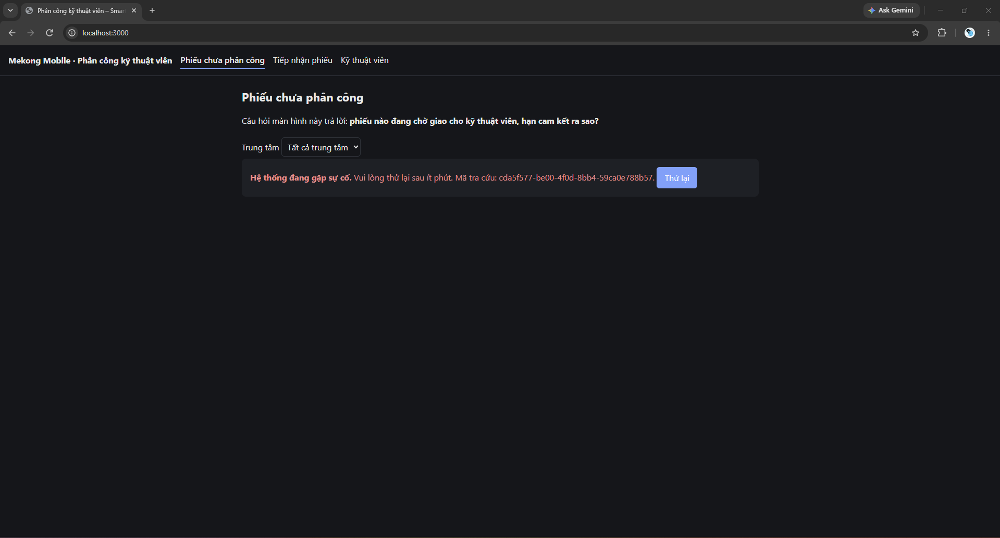

# Bằng chứng chạy bằng Docker (buổi 11–12)

Chạy trên máy sinh viên (Windows, Docker 28.5.2, Compose v2.40.3), từ thư mục chứa bản clone của repo, ngày 29/10/2026.

Từ ảnh:

- `docker compose up -d --build` dựng ảnh, tạo mạng và volume; container `db` báo **Healthy** sau 6,0 giây, rồi `api` được khởi động.
- Log của `api` cho thấy nó tự nạp dữ liệu mẫu trước khi mở cổng: `seeds: đã chạy 003_customers.sql`, `seeds: đã chạy 004_tickets.sql`, `seeds: xong (4 chạy, 0 bỏ qua)` (lần chạy đầu trên volume trống nên cả 4 tệp seed đều chạy), sau đó dòng JSON `máy chủ đã khởi động` ở cổng 3000.
- Mỗi yêu cầu có một dòng JSON với thời điểm +07:00, `requestId`, phương thức, đường dẫn, mã trạng thái và thời gian xử lý (trình duyệt tải trang rồi gọi `/api/tickets/unassigned`, mã 200).
- `docker compose ps`: cả `api` và `db` có STATUS **Up ... (healthy)**, không chỉ "running".
- Mở `http://localhost:3000/` trên máy host, màn hình "Phiếu chưa phân công" hiện 12 phiếu (dữ liệu mẫu đã nạp tự động, hệ thống không lên trống).

Cách làm lại: README mục 3.1. Quyết định thiết kế: TD-27 (`docs/thay-doi-thiet-ke.md`).

## Suy giảm có kiểm soát: tắt cơ sở dữ liệu khi hệ thống đang chạy (C7)

**Trước khi sửa lỗi (BUG-002).** Sau `docker compose stop db` trang không mở được (`ERR_CONNECTION_REFUSED`). Sau khi bật lại DB, `docker compose ps -a` cho thấy `api` đã thoát (`Exited (1)`), log kết thúc bằng thông tin lỗi chưa xử lý của Node.js v20:

**Sau khi sửa.** Với bản sửa (`src/db/pool.js`), chạy lại `docker compose stop db` rồi tải trang: máy chủ vẫn sống, giao diện báo lỗi rõ ràng kèm mã tra cứu và nút Thử lại, không treo, không trắng trang:

Mã tra cứu trên màn hình là `requestId` của yêu cầu; tìm được đúng dòng log lỗi tương ứng bằng `docker compose logs api`. Chi tiết lỗi ở `docs/bug-log.md` (BUG-002).

